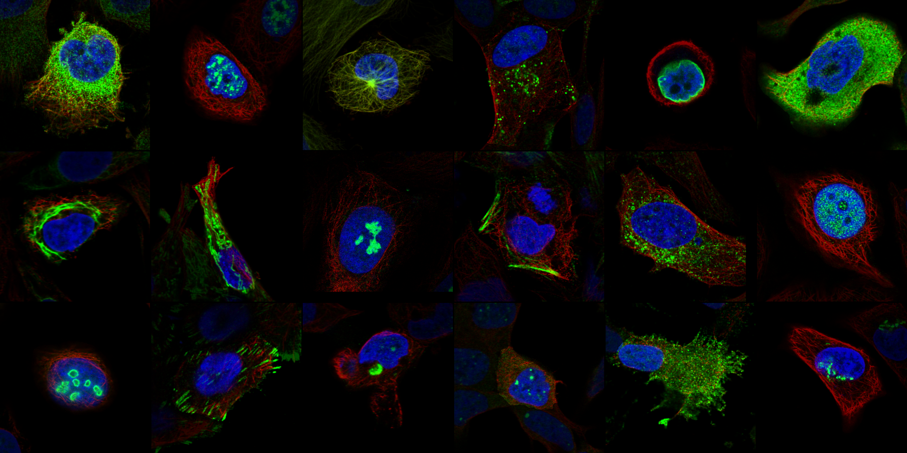
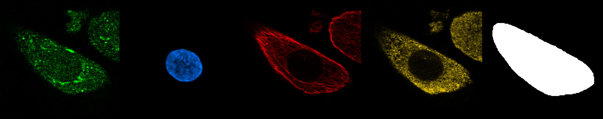
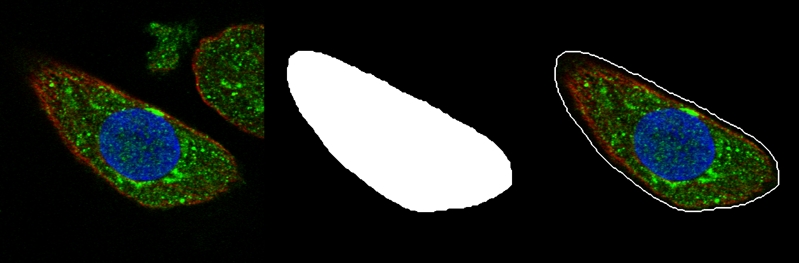

# Data

Models participating in this challenge will be evaluated on a set of unpublished "Human Protein Atlas style" images acquired in induced pluripotent stem cells (iPSCs; KOLF2.1J cell line) to test whether models generalize beyond protein sequences and cells represented in the imaging training data. We provide a training data set acquired from the same iPSCs in the same way.

Teams are encouraged to train on several standardized image data sets such as the [Human Protein Atlas (HPA) Subcellular Section](https://www.proteinatlas.org/humanproteome/subcellular), spanning over 40 cell lines and over 13,000 gene products, or the CM4AI MDA-MB-468 breast cancer cell line data set, covering untreated (DMSO, vehicle control) as well as chemotherapy-treated (paclitaxel, vorinostat) cells and over 400 gene products, capturing protein localization shifts driven by drug perturbation.

While the challenge itself is scored only on immunofluorescence (IF) image prediction in KOLF2.1J cells, we strongly encourage teams to leverage the complementary **multi-modal molecular data** (AP-MS, SEC-MS, Perturb-seq) generated by CM4AI to inform and improve their models. These orthogonal measurements of protein interaction, protein complex membership, and genetic function provide independent signal about where and how a protein is likely to localize.

### Data Types

* #### Immunofluorescence Imaging (IF)
  IF imaging visualizes the subcellular localization of a target protein using fluorescently labeled antibodies. The HPA and CM4AI image data are generated by staining a protein of interest alongside reference markers (nucleus, microtubules, endoplasmic reticulum), using antibodies against the protein of interest from the HPA. This is the primary modality of the challenge: models are asked to predict the protein (green) channel given the reference channels and the protein's amino acid sequence. CM4AI follows the HPA imaging and staining paradigm, enabling training on HPA and CM4AI MDA-MB-468 images and evaluation on CM4AI KOLF2.1J images. For more information on the method, see the the [HPA subcellular section webpage](https://www.proteinatlas.org/humanproteome/subcellular).

* #### Affinity Purification Mass Spectrometry (AP-MS)
  AP-MS identifies the direct and indirect binding partners of a bait protein: the bait is affinity-purified together with its interactors, which are then identified by mass spectrometry. The resulting protein-protein interaction (PPI) networks reveal the stable complexes a protein participates in, which can help predict its subcellular location. CM4AI has generated AP-MS interactomes in MDA-MB-468 breast cancer cells under paclitaxel and vorinostat treatment. See the [June 2026 Data Release](https://doi.org/10.18130/V3/HIGT4C) and [Clark et al., bioRxiv, 2024](https://doi.org/10.1101/2024.05.21.589311) for more details.

* #### Size Exclusion Chromatography Mass Spectrometry (SEC-MS)
  SEC-MS separates native protein complexes by size and quantifies the co-elution of proteins across fractions by mass spectrometry. Proteins that co-elute are likely members of the same complex, giving a complementary view of cellular organization. CM4AI SEC-MS data captures ~7,000 proteins across MDA-MB-468 cells (+/- treatment) and KOLF2.1J iPSCs and their differentiated derivatives (NPCs, neurons, cardiomyocytes). See the [June 2026 Data Release](https://doi.org/10.18130/V3/HIGT4C) and [Clark et al., bioRxiv, 2024](https://doi.org/10.1101/2024.05.21.589311) for more details.

* #### Perturb-seq
  Perturb-seq combines pooled CRISPR genetic perturbation (here CRISPRi) with single-cell RNA sequencing, reading out the transcriptional consequences of knocking down each targeted gene. The resulting functional signatures group genes into pathways and processes, offering another orthogonal axis of information about protein function and context. CM4AI has generated genome-scale Perturb-seq in KOLF2.1J iPSCs (>11,000 gene), published in Nature Biotechnology this year ([Nourreddine, S., Doctor, Y., *et al.* A genome-scale CRISPRi perturbation atlas of human induced pluripotent stem cells. *Nat Biotechnol* (2026)](https://doi.org/10.1038/s41587-026-03199-w)).

### Training Data

#### Human Protein Atlas (HPA)

The [Human Protein Atlas Subcellular Section](https://www.proteinatlas.org/humanproteome/subcellular) is a large, openly available resource mapping the spatiotemporal distribution of human proteins. It provides high-resolution immunofluorescence (ICC-IF) and confocal microscopy data on proteins encoded by over **13,000 genes** (majority of the intracellular proteins), imaged in up to three cell lines each, selected from a panel of **42 cell lines**. Each protein's localization has been expert-annotated into one or more of **49 organelles and subcellular structures**, spanning the nucleus, cytoplasm, and endomembrane system.

Each HPA image follows a standardized four-channel staining scheme: the **protein of interest** (green), imaged together with three reference channels (**nucleus** (blue), **microtubules** (red), and **endoplasmic reticulum** (yellow)). Because CM4AI imaging follows the same four-channel staining and acquisition paradigm, HPA serves as the primary large-scale training resource for the challenge, offering broad coverage across proteins, localization patterns, and cell types. The breadth of annotated localizations makes the HPA especially valuable for learning the full diversity of subcellular patterns a model must be able to generate.

For the challenge, we provide **ready-made single-cell crops** derived from HPA v25 field-of-view (FOV) images, so that teams can begin modeling immediately without running their own segmentation and cropping pipelines. The `HPA-train` set holds **1,245,396 cells** from 86,568 FOVs, **15,674 antibodies** and **39 cell lines**. KOLF2.1J images are not included in the `HPA-train` set.

**Figure 1. Example HPA single-cell crops.** A gallery of composite single-cell crops from the `HPA-train` set, shown as RGB overlays of the nucleus (blue) and microtubules (red) reference channels together with the protein of interest (green). For simplicity, the endoplasmic reticulum (yellow) is not shown in these example images. Each panel is one segmented cell, illustrating the diversity of cell morphologies, mitotic stages, and protein localization patterns represented in the training data.

---

**Data structure.** Each cell has a unique `image_key` (`<AntibodyID>_<CellLine>_<RandomKey>`) and is delivered as five 512×512 8-bit PNGs. Each antibody has one amino-acid sequence file. All files of an antibody are in one tar, `tars/<prefix>/<AntibodyID>.tar`:

| File (inside the tar) | Contents | Pseudocolor |
|---|---|---|
| `<AntibodyID>/<image_key>_protein.png` | protein of interest | green |
| `<AntibodyID>/<image_key>_nucleus.png` | nucleus | blue |
| `<AntibodyID>/<image_key>_microtubules.png` | microtubules | red |
| `<AntibodyID>/<image_key>_er.png` | endoplasmic reticulum | yellow |
| `<AntibodyID>/<image_key>_mask.png` | dilated whole-cell mask of the centre cell (255 inside, 0 outside) | — |
| `<AntibodyID>/<AntibodyID>.faa` | FASTA file with the protein sequence, one record per target gene | — |

The four channel images are not masked, so neighbouring cells can appear in them; only the centre cell is marked by the mask.

**Protein sequences.** Each FASTA file holds the longest amino acid sequence available for the stained protein (Ensembl release 109). Antibodies that target several genes have one FASTA record per gene. The header is `>hpa_antibody_id=<id>|ensembl_protein_id=<ENSP>|ensembl=109`.

**Dataset table.** `hpa_train_manifest.csv.gz` has one row per cell, with these columns:
- `image_key`
- `antibody_id`
- `ensembl_protein_id`, `ensembl_gene_id`, `gene_name`: `;`-separated for multi-target antibodies, in FASTA record order.
- `cell_line`
- `locations`: HPA's location annotation, `;`-separated, using 36 standard HPA terms. It is annotated per image, so every cell of an FOV has the same value. It is empty for cells HPA annotated as negative.
- `fov_key`: crops from the same FOV overlap.
- `tar_file`
- the paths of the five PNGs and of the sequence file inside the tar.

**Figure 2. Channel composition of a single-cell crop.** Each cell is delivered as five 512×512 8-bit PNGs. From left to right: `protein of interest` (green), `nucleus` (blue), `microtubules` (red), `endoplasmic reticulum` (yellow), and the binary cell mask (255 inside, 0 outside). Models are asked to predict the `protein of interest` channel from the three reference channels and the protein's amino acid sequence.

**Generation of single-cell crops.**
1. Cell and nucleus segmentation of every FOV.
2. A 1024×1024 crop centred on the cell's bounding box, plus the cell's mask.
3. Rescaling to the KOLF2.1J pixel size (0.0941867 µm/px; HPA source images are mostly 0.0800885 µm/px) and taking the central 512×512 window.
4. Linear conversion from 16 to 8 bit (`round(v × 255 / 65535)`), with no per-well or per-plate normalization.
5. Quality control. A cell is removed if:
   - its mask contains no nucleus;
   - more than 50% of the crop is zero padding (cells at the FOV edge are kept up to this limit);
   - the nucleus, microtubule or ER channel is empty;
   - the mask is broken;
   - the antibody has no annotated location in any of its images.

If you apply a model to your own crops, filter them the same way, in particular considering a nucleus inside the cell mask and at most 50% padding.

An example pipeline for image preprocessing from a full FOV microscopy picture to a single-cell image is available [here](https://github.com/cm4ai-anvil-dream-challenge/cm4ai-anvil-dream-preprocessing).

**Important Note on older HPA data:**
> Use only the current HPA release (v25). Do not attempt to complement the provided `HPA-train` set with images from earlier HPA releases or from the HPA Kaggle competitions (2018, 2021). HPA is continuously revised and selected images are removed for quality control reasons in revisions.

---

**Utility of the mask.** The cell mask allows you to confine training or evaluation to the centre cell of the crop. How to use the mask is up to you. Confining training to the mask region focuses the model on the target cell but makes it sensitive to segmentation quality and insensitive to the cell's environment. Not using the mask gives the model context from neighbouring cells, which are stained for the same protein, but it may also distract the model.

**Figure 3. Cell mask and region of interest.** From left to right: a nucleus, microtubules, and protein channel overlay, the binary cell mask for the target cell, and the overlay masked to the target cell and with the cell mask outline superimposed. The mask defines the single cell of interest within a crop that may also contain neighboring cells. This can aid in focusing training or evaluation on the targeted cell of interest.

#### Public CM4AI KOLF2.1J Image Data

A CM4AI iPSC (KOLF2.1J) image data set is provided as the challenge **training set**: **104,352 single cells** from 990 FOVs, stained for **495 antibodies** (494 genes), in the same file layout (tars, five PNGs per cell, one FASTA per antibody) and with the same 15-column dataset table (`kolf_train_manifest.csv.gz`) as the HPA set.

The KOLF2.1J crops were processed differently from the HPA crops:
- **Normalization:** intensities are normalized per well before the 8-bit conversion, because the KOLF2.1J images were acquired automatically with constant settings, while HPA images were acquired with optimized gain settings per staining.
- **Edge cells:** cells touching the FOV edge are excluded, so KOLF2.1J crops have no padding.
- **Mask:** the mask is the 7×7-dilated consensus whole-cell mask.

Pixel size (0.0941867 µm/px), image size (512×512) and bit depth (8 bit) of the training set are the same as in the HPA set. Intensity distributions are similar but not identical; for example, KOLF2.1J crops have a higher background. Full KOLF2.1J processing details are in the data and code repository.

**Things to know when combining the two sets:**
- **Cell size in the crop:** KOLF2.1J cells are small and fit in the crop. The median mask area is about 22,000 px, against about 99,000 px for HPA. About 47% of HPA masks touch the crop border, against 0.2% for KOLF2.1J.
- **Overlap between the sets:** 484 of the KOLF2.1J training antibodies are also in HPA-train, with identical FASTA files.
- **Validation splits:** several antibodies can target the same gene, and related genes have similar sequences. Split by gene (split the `;` lists) or by sequence similarity, not by antibody or FOV.

### Test Data

The held-out test set covers about **500 proteins** and about **50,000 single cell images** of KOLF2.1J iPSCs, in the same image format as the training crops.

 **Important Note:**
> Test files are named with a random identifier only. Unlike the training files, test file names contain no antibody id and no cell line. Your model must not rely on information from file names; it receives the reference channels (nucleus, microtubules, ER) and the protein's amino acid sequence.

The cell mask of each test cell is also provided. Using it is optional: for the score, the mask is applied automatically to the generated image (for most metrics; see the Evaluation section).

### Download

| Data set | Location | Content | Size |
|---|---|---|---|
| HPA-train_v1.0 | HPA-train_v1.0 folder | `tars/` (17 prefix folders, 15,674 tars), `hpa_train_manifest.csv.gz`, `LICENSE.txt` | 609 GB (tars 1.2–224 MB, median 34 MB) |
| KOLF-train_v1.0 | KOLF-train_v1.0 folder | `tars/` (10 prefix folders, 495 tars), `kolf_train_manifest.csv.gz`, `LICENSE.txt` | 80 GB |

### Additional Data

We encourage teams to incorporate the complementary CM4AI data sets to enrich sequence- and image-based predictions. These data are available through the CM4AI [June 2026 Data Release (Beta)](https://doi.org/10.18130/V3/HIGT4C) on the University of Virginia Dataverse (CC BY-NC-SA 4.0: non-commercial use; commercial use needs a separate licence).

#### Published CM4AI Molecular Data (KOLF2.1J iPSC)
Apart from the training set above, CM4AI has not released its KOLF2.1J IF images. It has released **orthogonal molecular data** on the same cell line, which teams may use to inform predictions:

| Modality | Cell line / state |
|---|---|
| SEC-MS | KOLF2.1J (undiff., NPC, neuron, cardiomyocyte) |
| Perturb-seq | KOLF2.1J (undifferentiated) |

For more information on the Perturb-seq data, see [Nourreddine, S., Doctor, Y., *et al.* A genome-scale CRISPRi perturbation atlas of human induced pluripotent stem cells. *Nat Biotechnol* (2026)](https://doi.org/10.1038/s41587-026-03199-w).

#### Published CM4AI Data (Breast Cancer Cell Line)
CM4AI's publicly released data in the **MDA-MB-468** triple-negative breast cancer (TNBC) line covers untreated (DMSO vehicle control), **vorinostat**, and **paclitaxel** conditions, enabling study of treatment-driven localization shifts.

| Modality | Cell line / condition |
|---|---|
| IF images | MDA-MB-468, untreated |
| IF images | MDA-MB-468, paclitaxel |
| IF images | MDA-MB-468, vorinostat |
| SEC-MS | MDA-MB-468 (+/- treatment) |
| AP-MS | MDA-MB-468, paclitaxel |
| AP-MS | MDA-MB-468, vorinostat |

### Licences and citation

- **HPA-train:** CC BY 4.0. Credit "Human Protein Atlas" and cite Thul et al., *Science* 2017. Sequences are from Ensembl release 109.
- **KOLF-train:** CC BY 4.0, with CM4AI attribution (see `LICENSE.txt`).
- **CM4AI Dataverse release:** CC BY-NC-SA 4.0.
