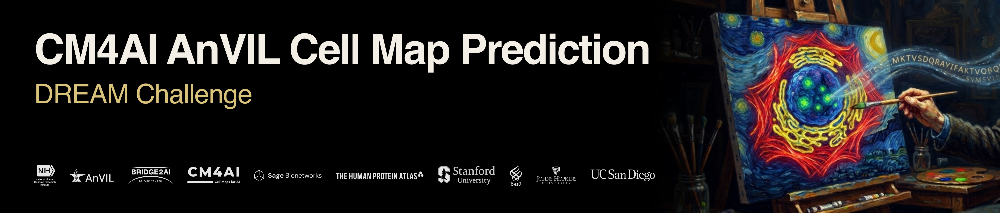

# Challenge overview

The spatial organization of proteins within cells underpins nearly all cellular functions. Accurate models of protein localization would bridge the gap between molecular- and cellular-scale biology, enabling a more unified understanding of how cells operate. However, current imaging techniques, such as primary immunofluorescence, can visualize only tens of protein species at a time, whereas a single human cell contains thousands. AI-driven prediction methods can close this gap, making it possible to generate comprehensive cell maps at a scale that existing imaging techniques alone cannot achieve. The goal of the CM4AI/AnVIL Cell Map Prediction DREAM Challenge is to bridge this gap. Participants will be presented reference microscopy images and requested to predict additional channels revealing where specified proteins would localize within those cells. This Challenge brings together the massive amounts of data generated by the Bridge2AI project and the NHGRI's AnVIL cloud genomics platform. This challenge provides a unique opportunity to develop more flexible and generalizable generative image models that are capable of simulating the subcellular protein localization of a given protein based on its sequence, paving avenues for a new era of _in silico_ microscopy experiments.

## Join the challenge
[Register for the challenge on Synapse](https://www.synapse.org/Team:3613145)

## Cell Maps For AI
The [Bridge2AI](https://bridge2ai.org/) [Cell Maps for AI (CM4AI)](https://cm4ai.org/) data generation project seeks to map the spatiotemporal architecture of human cells and use these maps toward the grand challenge of interpretable genotype-phenotype learning, essentially building "virtual cell" models. The CM4AI project has generated new flagship datasets for functional genomics using SEC-MS, AP-MS, and immunofluorescence (IF) data to develop cell maps for multiple cell lines [[1](https://www.biorxiv.org/content/10.1101/2024.05.21.589311v1)].

## AnVIL
The NHGRI [AnVIL (Genomic Data Science Analysis, Visualization, and Informatics Lab-space)](https://anvilproject.org/) is a cloud-based platform designed for sharing, managing, and analyzing large-scale genomic datasets. The AnVIL is the NHGRI's collaborative computing platform in the cloud that hosts genomic datasets such as 1000 Genomes, GREGoR, eMERGE and GTEX. It enables Cloud-Based Models, Scalable Computing, Data Management with Security that meets federal standards. Using the reproducible computing technology of the AnVIL platform, participants will submit models that can be applied to new datasets.

## The Challenge
This challenge will advance the development of generative AI models capable of predicting protein subcellular localization from microscopy images. The primary benefit will be to establish new generative image models in biology that can simulate the subcellular distribution of a protein, while encouraging creative solutions for integrating multi-modal molecular data to enable spatially precise protein image prediction. Participating teams will be asked to generate IF microscopy images of target proteins given their amino acid sequences and reference channel images. See References [[2](https://www.biorxiv.org/content/10.64898/2026.03.31.715748v2.full), [3](https://www.nature.com/articles/s41592-026-03142-6), [5](https://www.biorxiv.org/content/10.64898/2026.06.01.729395v1.full)-[7](https://www.nature.com/articles/s41592-025-02696-1)] for relevant background publications.

Participating teams will be asked to generate fluorescence microscopy images of target proteins given their amino acid sequences and reference channel images, with access to training data from the Human Protein Atlas and a public CM4AI iPSC image dataset covering of 50,000 cells each stained for one of 500 disclosed proteins.

We evaluate submissions on a hidden test set comprising images of 50,000 cells for the 500 disclosed proteins and 50,000 cells stained with one of 400 undisclosed proteins.

### Challenge Organizers / Scientific Advisory Board
* Emma Lundberg, Stanford University
* Jan Hansen, Stanford University
* Trey Ideker, University of California, San Diego
* Kyle Ellrott, Oregon Health & Science University
* Michael Schatz, Johns Hopkins University
* Shurjo Sen, NHGRI, NIH
* Laura Heiser, Ohregon Health & Science University
* Gustavo Stolovitzky, NYU Langone Health

#### References
1. [Cell Maps for Artificial Intelligence: AI-Ready Maps of Human Cell Architecture from Disease-Relevant Cell Lines](https://www.biorxiv.org/content/10.1101/2024.05.21.589311v1)
2. [Generative machine learning unlocks the first proteome-wide image of human cells](https://www.biorxiv.org/content/10.64898/2026.03.31.715748v2.full)
3. [A comprehensive benchmark of sequence-based subcellular localization predictors for human proteins](https://www.nature.com/articles/s41592-026-03142-6)
4. [A subcellular map of the human proteome](https://www.science.org/doi/10.1126/science.aal3321)
5. [Vermeer: Autoregressive generative modeling of microscopy predicts protein localization](https://www.biorxiv.org/content/10.64898/2026.06.01.729395v1.full)
6. [CELL-Diff: Unified Diffusion Modeling for Protein Sequences and Microscopy Images](https://www.biorxiv.org/content/10.1101/2024.10.15.618585v1.full)
7. [Prediction of protein subcellular localization in single cells](https://www.nature.com/articles/s41592-025-02696-1)
